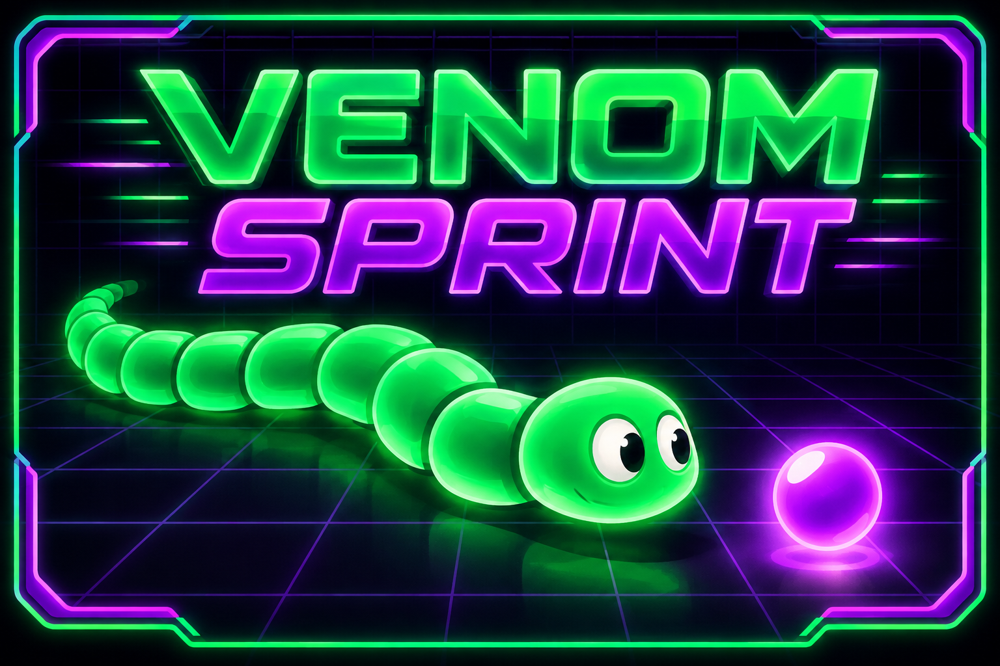
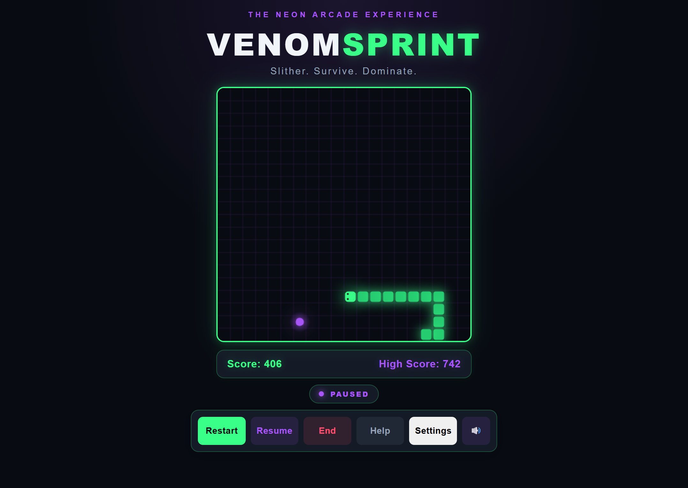

# 🐍 Venom-Sprint 2.0

### Slither. Survive. Dominate.



### Gameplay Preview



**Venom-Sprint 2.0** is a modern, arcade-inspired Snake game built entirely with **vanilla JavaScript, HTML5, and CSS3**.

Featuring a neon-inspired interface, responsive game board, dynamic difficulty, and interactive player controls, Venom-Sprint brings a fresh visual experience to the classic Snake game.

Venom-Sprint 2.0 is a portfolio-ready browser game showcasing modular JavaScript architecture, HTML5 Canvas rendering, responsive design, accessibility improvements, arcade audio, customizable visual settings, and automated regression testing.

## 🎮 Live Demo

Play Venom-Sprint 2.0 directly in your browser:

**[Play Venom-Sprint 2.0](https://geniozx.github.io/Venom-Sprint/)**

No installation required. Supports desktop and mobile devices.

**[View Source Code](https://github.com/Geniozx/Venom-Sprint)**

---

## 🎮 Features

### ✨ Venom-Sprint 2.0 Arcade Enhancements

Phase 5 introduces a polished arcade experience with enhanced visuals, sound effects, customizable settings, and improved result screens.

#### Visual Enhancements

- Neon green snake with a directional head and rounded body segments.
- Glowing purple food with a soft radial halo.
- Refined Canvas rendering and arcade-inspired visual effects.
- Custom neon arcade splash artwork.
- Responsive gameplay presentation across desktop and mobile devices.

#### Arcade Audio

- Sound effects for starting, pausing, and resuming gameplay.
- Food collection feedback.
- Distinct Game Over and Victory sounds.
- Dedicated Sound On/Off control.
- Sound preferences saved using browser local storage.

#### Customizable Settings

- Settings modal accessible from the main controls.
- Show Grid option to enable or disable the game-board grid.
- Visual Effects option to enable or disable snake and food glow effects.
- Settings saved automatically using browser local storage.
- Preferences restored when the page reloads.
- Keyboard-accessible settings with focus management and Escape key support.

#### Enhanced Result Screens

- Dedicated Game Over and Victory overlays.
- Final score displayed prominently.
- Neon arcade styling and animations.
- Play Again functionality.
- Keyboard focus management for result interactions.

### 🐍 Classic Snake Gameplay

- Control the snake using the arrow keys.
- Collect food to increase your score.
- Grow longer each time food is collected.
- Avoid collisions with walls and the snake's body.
- Experience progressively faster gameplay as your score increases.

### ⚡ Dynamic Difficulty

- The game begins at a manageable speed.
- Movement speed increases as food is collected.
- The speed increase introduces progressively greater challenges.

### 🏆 Scoring System

Venom-Sprint 2.0 features a movement-based scoring system that rewards both survival and food collection.

- **+1 point** for every successful movement.
- **+10 bonus points** for collecting food.
- Collecting food awards **11 points total** for that movement.
- No points are awarded for movements that result in a collision.
- Real-time score tracking throughout gameplay.
- High-score tracking using browser local storage.
- High scores persist between browser sessions.

High scores are stored using the `venomSprint_v2_highScore` local storage key.

### 🎛️ Interactive Game Controls

Venom-Sprint supports both desktop keyboard controls and touchscreen gameplay.

- **Desktop:** Use the arrow keys to move the snake.
- **Space Bar:** Start, pause, or resume gameplay.
- **Mobile:** Use the on-screen directional controls to move the snake.
- **Mobile Start:** Tap the "Tap Here to Start" button to begin gameplay.
- **Restart:** Begin a new game.
- **Pause / Resume:** Temporarily stop or continue gameplay.
- **End:** Stop the current game.
- **Help:** Open an instructional modal explaining gameplay and controls.
- **Settings:** Open the settings modal to customize grid visibility and visual effects.
- **Sound On / Off:** Toggle arcade sound effects without interrupting gameplay.

Directional input includes reverse-direction protection and movement-tick locking to prevent invalid or excessively rapid direction changes.

On mobile devices, the six primary action controls are arranged in two rows of three buttons for improved accessibility and usability.

### 🎨 Neon Arcade Interface

Venom-Sprint 2.0 introduces a redesigned visual experience featuring:

- Dark arcade-inspired backgrounds.
- Neon green and purple accent colors.
- Glowing game-board borders.
- Redesigned scoreboard.
- Modern interactive buttons.
- Styled instructional modal.
- Updated Venom-Sprint branding.

### 🔒 Direction Locking

- Prevents multiple direction changes within a single movement tick.
- Blocks immediate reverse-direction movement.
- Accepts valid direction changes when the direction lock is released.
- Helps prevent accidental self-collisions caused by rapid keyboard input.

### 🏆 Full-Board Victory

- Detects when the snake occupies every available grid cell.
- Recognizes when no additional food can be generated.
- Ends gameplay with a dedicated Victory overlay.
- Provides a Play Again button to start a new game.

### 🎯 Gameplay Feedback

- Displays the current gameplay status: Ready, Playing, Paused, Game Over, or Victory.
- Uses a dedicated Game Over overlay instead of a browser alert.
- Provides distinct Game Over and Victory messages.
- Keeps gameplay status synchronized with game events.

### 📱 Responsive Design

Venom-Sprint 2.0 includes a responsive gameplay interface optimized for desktop and mobile devices.

- Responsive game board that adapts to available viewport dimensions.
- Compact mobile header and gameplay layout.
- Dedicated mobile directional controls.
- Two-row mobile D-pad with comfortable touchscreen targets.
- Mobile action controls arranged in two rows of three buttons for improved usability.
- Responsive scoreboard and gameplay status indicators.
- Viewport-aware game board sizing.
- Mobile start button integrated into the game board.
- Reduced unnecessary vertical spacing and scrolling.
- Verified responsive layouts at 360 × 640, 390 × 844, and 430 × 932 viewport dimensions.

### ♿ Accessibility Improvements

Venom-Sprint includes accessibility features designed to improve keyboard navigation, screen-reader compatibility, and touchscreen usability.

- Semantic HTML structure and explicit button types.
- Descriptive Canvas labeling and fallback text.
- Visible keyboard focus indicators.
- Keyboard-accessible gameplay controls.
- Accessible Help modal with dialog semantics.
- Automatic focus management when opening and closing the Help modal.
- Keyboard focus containment while the Help modal is open.
- Escape key support for closing the Help modal.
- Accessible labels for mobile directional controls.
- ARIA status announcements configured using `role="status"` and `aria-live="polite"`.
- Accessible Game Over and Victory dialog markup.
- Support for reduced-motion preferences.
- Touchscreen controls designed to prevent accidental page scrolling during directional input.

Keyboard interaction, accessibility attributes, and mobile usability have been manually verified. Full screen-reader announcement testing remains a future enhancement.

---

## 🕹️ How to Play

1. Open Venom-Sprint in your browser.
2. Press **Space** to begin playing.
3. Use the arrow keys to control the snake.
4. Collect food to earn points and grow longer.
5. Avoid colliding with the walls or your own body.
6. Survive as long as possible and attempt to beat your high score.

### Keyboard Controls

| Key | Action |
|---|---|
| ↑ | Move up |
| ↓ | Move down |
| ← | Move left |
| → | Move right |
| Space | Start the game |
| Space (during gameplay) | Pause the game |
| Space (while paused) | Resume the game |

Holding Space does not repeatedly toggle the pause state.

The game can also be started or restarted using the **Restart** button.

### Mobile Controls

Venom-Sprint supports touchscreen gameplay on mobile devices.

1. Open Venom-Sprint in a mobile browser.
2. Tap **Tap Here to Start** to begin gameplay.
3. Use the on-screen directional buttons to control the snake.
4. Collect food to increase your score.
5. Avoid collisions with walls and your snake's body.
6. Use the Restart, Pause, End, and Help buttons as needed.

#### Mobile Directional Controls

| Button | Action |
|---|---|
| ▲ | Move up |
| ▼ | Move down |
| ◀ | Move left |
| ▶ | Move right |

The mobile directional controls share the same movement validation and direction-locking behavior as desktop keyboard controls.

The mobile interface automatically adjusts the game board and controls to fit different viewport sizes.

### Interface Controls

| Button | Action |
|---|---|
| Restart | Start a new game |
| Pause / Resume | Pause or resume gameplay |
| End | End the current game |
| Help | Display gameplay instructions |

---

## 🛠️ Technology Stack

Venom-Sprint is intentionally built without JavaScript frameworks.

| Technology | Purpose |
|---|---|
| HTML5 | Page structure and game canvas |
| CSS3 | Styling, animations, and responsive layouts |
| JavaScript (ES Modules) | Modular gameplay logic and user interactions |
| Canvas API | Rendering the snake, food, grid, and visual effects |
| Web Audio API | Generating arcade sound effects |
| Local Storage API | Persisting high scores, audio preferences, and visual settings |
| Node.js Test Runner | Automated gameplay and control regression tests |
| Git | Version control |
| GitHub | Source code hosting and GitHub Pages deployment |

---

## 📁 Project Structure

```text
Venom-Sprint/
│
├── assets/
│   ├── images/
│   │   └── Neon Venom Sprint Arcade Splash.png
│   └── screenshots/
│       └── venom-sprint-gameplay-thumbnail.png
│
├── css/
│   └── style.css
│
├── js/
│   ├── app.js
│   ├── audio.js
│   ├── config.js
│   ├── controls.js
│   ├── food.js
│   ├── game.js
│   ├── main.js
│   ├── renderer.js
│   ├── settings.js
│   ├── snake.js
│   └── storage.js
│
├── tests/
│   ├── controls.test.js
│   ├── food.test.js
│   ├── game.test.js
│   └── snake.test.js
│
├── index.html
├── package.json
└── README.md
```

### JavaScript Architecture

Venom-Sprint 2.0 uses native JavaScript ES modules to separate application responsibilities and improve maintainability.

| Module | Responsibility |
|---|---|
| `main.js` | Application entry point |
| `app.js` | Coordinates gameplay events, audio, settings, and browser interface updates |
| `audio.js` | Generates arcade sound effects using the Web Audio API and manages sound preferences |
| `config.js` | Centralizes grid dimensions and speed configuration |
| `controls.js` | Manages keyboard input, game buttons, and modal interactions |
| `food.js` | Generates food in unoccupied grid cells |
| `game.js` | Manages game state, scoring, timers, and lifecycle |
| `renderer.js` | Renders the snake, food, grid, and visual effects using HTML5 Canvas |
| `settings.js` | Manages persistent visual preferences, including grid visibility and effects |
| `snake.js` | Handles snake initialization, movement, growth, and collision detection |
| `storage.js` | Manages persistent high-score storage |

### Architecture Overview

```text
index.html
    │
    ▼
  main.js
    │
    ▼
  app.js
    │
    ├── controls.js
    │
    ├── audio.js
    │
    ├── settings.js
    │
    ├── game.js
    │     ├── snake.js
    │     ├── food.js
    │     └── config.js
    │
    ├── renderer.js
    │
    └── storage.js
```

The application coordinator connects user input, gameplay logic, rendering, and persistent storage.

The game engine communicates gameplay events through callbacks, allowing rendering and interface updates to remain separate from core game rules.

### Directory Overview

**`assets/images/`**
Contains the neon arcade splash artwork and game branding assets.

**`assets/screenshots/`**
Contains the active gameplay screenshot used for the README and developer portfolio.

**`css/`**
Contains the arcade design system, responsive layouts, animations, and component styling.

**`js/`**
Contains the modular JavaScript application, including gameplay logic, Canvas rendering, audio, settings, and browser interactions.

**`tests/`**
Contains automated regression tests for gameplay, snake movement, food generation, and controls.

**`index.html`**
Provides the main application structure, game canvas, controls, Help modal, and Settings modal.

**`package.json`**
Defines project metadata and the automated test command.

**`README.md`**
Documents the project's features, architecture, setup instructions, testing, and development roadmap.

---

## 🚀 Getting Started

### Prerequisites

You need:

- A modern web browser.
- Python 3 or another local HTTP server.
- Git, if you want to clone the repository.
- A code editor such as Visual Studio Code (optional).
- Node.js 20 or later (only required for automated testing).

### Installation

**1. Clone the repository**

```bash
git clone https://github.com/Geniozx/Venom-Sprint.git
```

**2. Navigate into the project**

```bash
cd Venom-Sprint
```

**3. Start a local development server**

Using Python 3:

```bash
python3 -m http.server 5500 --bind 0.0.0.0
```

**4. Open the application**

Visit:

`http://localhost:5500`

**5. Start playing**

Press **Space** or click **Restart** to begin.

### Development Notes

Venom-Sprint uses native JavaScript ES modules.

The application should be served over HTTP rather than opened directly using the `file://` protocol.

No npm installation, JavaScript framework, or build process is required to play the game.

### Automated Testing

Venom-Sprint includes a permanent automated regression test suite built with Node.js and its native test runner.

No third-party testing libraries are required.

To run the tests, navigate to the project directory and execute:

```bash
npm test
```

The test command executes all test files inside the `tests/` directory.

The regression suite covers:

- Snake movement, growth, and collision detection.
- Food generation and full-board detection.
- Scoring and victory conditions.
- Game state resets and lifecycle management.
- Pause/resume functionality and timer behavior.
- Direction locking and keyboard input validation.
- Speed acceleration and minimum delay enforcement.

**Latest verification (Phase 5):** 32 automated tests passed with zero failures.

Phase 5 final quality assurance also confirmed:

- **32/32 automated regression tests passed.**
- **7/7 JavaScript syntax checks passed.**
- **60/60 manual QA checks passed**, covering gameplay, arcade audio, customizable settings, mobile responsiveness, and splash artwork.

These results were verified before preparing the Venom-Sprint 2.0 release.

The automated suite covers core gameplay and keyboard input behavior. Mobile touchscreen interactions and modal accessibility were additionally verified through manual browser and physical-device testing.

Node.js is required for automated testing but is not required to run the game in a browser.

---

## 🎨 Design System

Venom-Sprint 2.0 uses a centralized CSS design system.

### Primary Colors

| Color | Hex | Purpose |
|---|---|---|
| Dark Background | `#080b12` | Primary background |
| Surface | `#141a26` | UI containers |
| Neon Green | `#39ff88` | Primary accent |
| Neon Purple | `#a855f7` | Secondary accent |
| Neon Red | `#ff4d6d` | Danger actions |
| Primary Text | `#f1f5f9` | Main typography |
| Secondary Text | `#94a3b8` | Supporting typography |

The stylesheet also defines reusable variables for borders, glow effects, border radii, and transitions.

---

## 🗺️ Development Roadmap

### ✅ Phase 1 — Project Foundation & Arcade UI

**Status: Complete**

- Reorganized project directories.
- Introduced the Venom-Sprint 2.0 branding.
- Created a centralized CSS design system.
- Modernized the HTML structure.
- Redesigned the game board.
- Redesigned the scoreboard.
- Redesigned the control buttons.
- Redesigned the Help modal.
- Implemented viewport-responsive sizing.
- Improved narrow-screen layouts.
- Added initial accessibility enhancements.
- Verified existing gameplay functionality.

### ✅ Phase 2 — JavaScript Architecture

**Status: Complete**

Refactored Venom-Sprint into a modular JavaScript application using native ES modules.

#### Architecture Improvements

- Introduced nine dedicated JavaScript modules.
- Established `main.js` as the application entry point.
- Centralized game configuration.
- Centralized gameplay state and lifecycle management.
- Separated snake movement and collision detection.
- Isolated food generation.
- Separated Canvas rendering from gameplay logic.
- Centralized keyboard and button controls.
- Extracted persistent high-score management.
- Introduced callback-based communication between gameplay logic and the application interface.

#### Gameplay Improvements

- Implemented movement-based scoring.
- Added a 10-point food collection bonus.
- Prevented food from spawning inside the snake.
- Improved timer management to prevent duplicate intervals.
- Implemented Space Bar start, pause, and resume controls.
- Prevented repeated Space Bar events from rapidly toggling pause.
- Fixed Restart behavior before the initial game starts.
- Synchronized the Pause/Resume button with gameplay state.
- Improved game-over lifecycle cleanup.
- Preserved high scores between browser sessions.

#### Testing and Verification

- Completed module-by-module functionality testing.
- Verified gameplay state transitions.
- Verified scoring and collision behavior.
- Verified timer creation and cleanup.
- Verified pause/resume behavior.
- Verified module loading through browser DevTools.
- Completed 20 final gameplay regression checks.
- Verified responsive layout and browser console behavior.

**Result:** Phase 2 established a maintainable foundation for future gameplay enhancements without introducing JavaScript frameworks.

### ✅ Phase 3 — Gameplay Improvements

**Status: Complete**

Phase 3 focused on strengthening gameplay reliability, improving player feedback, and introducing permanent automated regression testing.

The improvements build upon the modular JavaScript architecture established during Phase 2.

#### Direction Locking

- Implemented direction locking to prevent multiple direction changes within a single movement tick.
- Prevented rapid keyboard input from bypassing reverse-direction protection.
- Automatically releases the direction lock after each movement tick.
- Preserved valid directional input when the game is active and the direction lock is released.
- Verified direction locking and reverse-direction protection through automated regression tests.

#### Movement and Collision Reliability

- Verified movement in all four directions.
- Strengthened testing around wall and self-collisions.
- Confirmed that the snake grows correctly when food is consumed.
- Verified that unsuccessful movements do not award points.
- Preserved the movement-based scoring system introduced during Phase 2.

#### Full-Board Victory

- Implemented victory detection when the snake occupies every available grid cell.
- Updated food generation to return `null` when no unoccupied cells remain.
- Integrated victory detection into the game engine.
- Added a dedicated victory callback to the gameplay lifecycle.
- Verified full-board victory through automated regression testing.

#### Game Over and Victory Interface

- Replaced browser-alert game-over feedback with a dedicated result overlay.
- Introduced distinct Game Over and Victory messages.
- Added a Play Again action to restart gameplay.
- Integrated result overlays with the existing game lifecycle.
- Verified overlay behavior through manual browser testing.

#### Gameplay Status Indicators

- Introduced visible gameplay status indicators.
- Added support for Ready, Playing, Paused, Game Over, and Victory states.
- Synchronized status indicators with gameplay events.
- Improved player feedback during game transitions.
- Verified status behavior through manual browser testing.

#### Permanent Automated Regression Testing

Introduced a permanent automated test suite using Node.js and its built-in test runner.

The suite covers:

- Snake initialization and directional movement.
- Snake growth and collision detection.
- Food generation and full-board detection.
- Movement scoring and food collection bonuses.
- Collision scoring protection.
- Full-board victory detection.
- Game state initialization and reset behavior.
- Speed restoration and acceleration limits.
- Pause and resume functionality.
- Inactive game protection.
- Game-over lifecycle cleanup.
- Timer startup and shutdown.
- Paused gameplay protection.
- Direction locking and keyboard input validation.

The project includes a dedicated `tests/` directory and an npm test command.

Run the automated regression suite with:

```bash
npm test
```

**Final Phase 3 regression results:**

```text
Tests: 31
Passed: 31
Failed: 0
```

#### Phase 3 Verification

- Completed manual browser verification of the Game Over and Victory result overlay.
- Completed manual browser verification of gameplay status indicators.
- Verified core gameplay functionality through automated regression testing.
- Confirmed that all 31 permanent regression tests pass.

**Result:** Phase 3 improved gameplay reliability, introduced clearer player feedback, and established a permanent automated testing foundation for future development.

### ✅ Phase 4 — Accessibility & Mobile Controls

**Status: Complete**

Phase 4 focused on improving accessibility, introducing touchscreen gameplay, and optimizing the mobile experience while preserving existing desktop functionality.

#### Help Modal Accessibility

- Added accessible dialog semantics to the Help modal.
- Implemented automatic keyboard focus management.
- Added keyboard focus containment within the modal.
- Added Escape key support for closing the modal.
- Restored focus to the Help button when the modal closes.
- Verified keyboard navigation using Tab and Shift + Tab.
- Confirmed visible keyboard focus indicators.

#### Mobile Directional Controls

- Introduced a dedicated mobile D-pad.
- Added Up, Down, Left, and Right directional buttons.
- Implemented shared direction validation for keyboard and mobile input.
- Preserved reverse-direction protection.
- Preserved movement-tick direction locking.
- Added descriptive accessibility labels to directional buttons.
- Prevented unwanted page scrolling during D-pad interaction.
- Verified directional gameplay on a physical mobile device.

#### Mobile Start Interaction

- Added a responsive mobile start instruction.
- Preserved the desktop Space Bar instruction.
- Introduced a dedicated "Tap Here to Start" button.
- Connected the mobile Start button to the existing gameplay lifecycle.
- Verified mobile game initialization and desktop keyboard compatibility.

#### Responsive Mobile Layout

- Reorganized the CSS stylesheet for improved maintainability.
- Consolidated mobile responsive rules.
- Reduced unnecessary mobile header spacing.
- Optimized the mobile D-pad into a compact two-row layout.
- Initially organized mobile action controls into a single row; later refined the layout to two rows of three buttons during Phase 5.
- Introduced viewport-aware mobile game board sizing.
- Eliminated vertical overflow at the tested 668px viewport height.
- Verified layouts at 360 × 640, 390 × 844, and 430 × 932.
- Confirmed that the game board and controls remain accessible.
- Verified Game Over overlay readability and Play Again functionality.

#### Accessibility Verification

- Verified Help modal keyboard navigation.
- Verified keyboard gameplay controls.
- Confirmed visible focus indicators.
- Verified accessible labels for mobile directional controls.
- Confirmed ARIA attributes for gameplay status updates.
- Verified accessible Help and result dialog markup.
- Completed physical mobile usability testing.

#### Regression Testing

Completed the permanent automated regression suite using Node.js.

**Final Phase 4 automated test results:**

```text
Tests: 31
Passed: 31
Failed: 0

```

### ✅ Phase 5 — Arcade Polish, Final QA & Deployment

**Status: Complete — Venom-Sprint 2.0 Released**

Phase 5 transforms Venom-Sprint into a polished, portfolio-ready arcade game with enhanced visuals, audio, customizable settings, and comprehensive quality assurance.

#### 5.1 — Gameplay Visual Polish ✅

- Introduced a neon arcade visual style.
- Enhanced the snake with directional eyes and rounded, glowing body segments.
- Redesigned food with a glowing circular appearance.
- Refined the game board and grid rendering.
- Added polished arcade splash artwork.

#### 5.2 — Arcade Sound Effects ✅

- Introduced sound effects using the Web Audio API.
- Added audio feedback for gameplay events, including food collection, game over, victory, and pause/resume.
- Added a dedicated sound toggle.
- Persisted sound preferences using local storage.

#### 5.3 — Result Screen Polish ✅

- Enhanced Game Over and Victory overlays.
- Improved score presentation and visual animations.
- Refined Play Again interactions.
- Improved keyboard focus management and accessibility.

#### 5.4 — Settings & Customization ✅

- Introduced a dedicated Settings modal.
- Added Show Grid and Visual Effects preferences.
- Persisted visual preferences using local storage.
- Implemented accessible modal keyboard navigation.
- Integrated settings into Canvas rendering.

#### 5.5 — Final QA & Testing ✅

- Passed all 32 automated regression tests.
- Passed all 7 JavaScript syntax checks.
- Completed 60 manual QA checks.
- Verified gameplay, audio, settings, mobile controls, and splash artwork.
- Removed temporary testing code.

#### 5.6 — Portfolio Preparation & Deployment ✅

- Completed production-readiness checks.
- Configured GitHub Pages deployment from `main` and `/(root)`.
- Prepared a dedicated gameplay screenshot for the README and portfolio.
- Completed final project documentation.
- Committed and pushed the Venom-Sprint 2.0 release to GitHub.
- Successfully deployed Venom-Sprint 2.0 to GitHub Pages.
- Verified that the live game loads and functions correctly.

**Live Demo:** [Play Venom-Sprint 2.0](https://geniozx.github.io/Venom-Sprint/)


**Release target:** Venom-Sprint 2.0 — portfolio-ready arcade game.

---

## Venom-Sprint 2.1 — Improvements & Enhancements 🚧

Venom-Sprint 2.1 builds upon the completed 2.0 release, focusing on improved mobile compatibility, more responsive controls, balanced gameplay progression, and expanded competitive features.

### 2.1.1 — Cross-Platform Mobile Directional Controls ✅

- Replaced Unicode directional triangles with inline SVG graphics.
- Resolved inconsistent directional-arrow rendering on iPhone browsers.
- Preserved the existing neon arcade styling across devices.
- Maintained accessible labels and directional button attributes.
- Verified correct rendering of all four directional arrows on mobile devices.

### 2.1.2 — Mobile Input Responsiveness ✅

- Updated mobile directional controls to use `pointerdown` for immediate input handling.
- Preserved keyboard accessibility through the existing click fallback.
- Prevented duplicate direction handling from pointer-generated click events.
- Retained shared direction validation and movement-locking behavior.
- Verified mobile responsiveness during extended gameplay.
- Confirmed desktop keyboard controls continue functioning correctly.

### 2.1.3 — Gameplay Speed Balancing ✅

- Reduced the speed increment from 10ms to 3ms per food pickup.
- Preserved the initial movement interval of 200ms.
- Preserved the minimum movement interval of 50ms.
- Extended progression to maximum speed from 15 to 50 food pickups.
- Improved the difficulty curve by introducing more gradual acceleration.
- Manually tested and approved the updated speed progression.

### 2.1.4 — Global Leaderboard ⏳ Planned

- Introduce a universal leaderboard shared across players.
- Allow players to compete for high-score rankings.
- Design persistent score storage and retrieval.
- Implement score submission and leaderboard display.
- Evaluate score-validation measures to reduce fraudulent submissions.

**Development status:** Venom-Sprint 2.1 is in active development. Mobile controls and speed balancing are complete; the global leaderboard remains planned.

---

### ⏳ Future Enhancements

Potential additions include:

- Dedicated pause overlay.
- Expanded scoring features and achievements.
- Additional game modes and difficulty presets.
- Optional music and expanded arcade soundtracks.
- Screen-reader testing with VoiceOver and TalkBack.
- Expanded automated browser interaction testing.
- Additional cross-browser compatibility testing.

These features are planned or under consideration and are not part of the current implementation.

---

## ⚠️ Known Limitations

Venom-Sprint 2.0 has completed its planned development, final quality assurance, and production deployment. The game is publicly available through GitHub Pages and has been verified to function correctly in the tested environments.

The following areas remain opportunities for future improvement:

- Full screen-reader verification using VoiceOver and TalkBack.
- Broader browser and device compatibility testing.
- Expanded automated testing for browser-specific interactions and interface behavior.
- Further responsive optimization for unusually small mobile viewports.
- Additional gameplay modes, scoring features, and customization options.

These limitations do not prevent the game from functioning in the environments tested during development.

### Development Milestones

**Phase 3** resolved direction-locking, full-board victory, and browser-alert game-over limitations.

**Phase 4** introduced mobile touchscreen controls, improved keyboard and modal accessibility, and optimized responsive gameplay layouts.

**Phase 5** introduced neon arcade visuals, sound effects, customizable settings, enhanced result screens, and comprehensive final quality assurance.

Future development will focus on continued accessibility improvements, gameplay enhancements, and broader browser compatibility.


