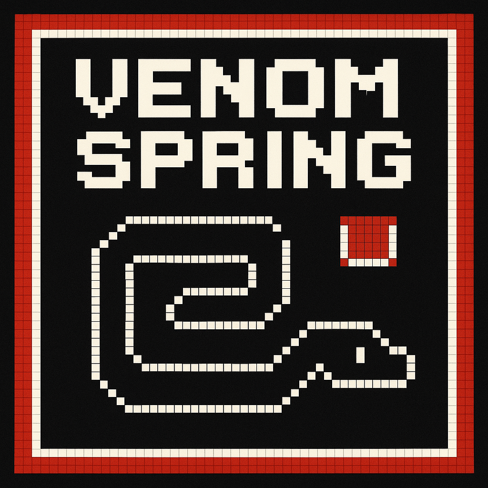

# 🐍 Venom-Sprint 2.0

### Slither. Survive. Dominate.



**Venom-Sprint 2.0** is a modern, arcade-inspired Snake game built entirely with **vanilla JavaScript, HTML5, and CSS3**.

Featuring a neon-inspired interface, responsive game board, dynamic difficulty, and interactive player controls, Venom-Sprint brings a fresh visual experience to the classic Snake game.

The project is being developed as a portfolio-ready browser game, with an emphasis on clean architecture, responsive design, accessibility, and maintainable JavaScript.

---

## 🎮 Features

### 🐍 Classic Snake Gameplay

- Control the snake using the arrow keys.
- Collect food to increase your score.
- Grow longer each time food is collected.
- Avoid collisions with walls and the snake's body.
- Experience progressively faster gameplay as your score increases.

### ⚡ Dynamic Difficulty

- The game begins at a manageable speed.
- Movement speed increases as food is collected.
- The speed increase introduces progressively greater challenges.

### 🏆 Scoring System

Venom-Sprint 2.0 features a movement-based scoring system that rewards both survival and food collection.

- **+1 point** for every successful movement.
- **+10 bonus points** for collecting food.
- Collecting food awards **11 points total** for that movement.
- No points are awarded for movements that result in a collision.
- Real-time score tracking throughout gameplay.
- High-score tracking using browser local storage.
- High scores persist between browser sessions.

High scores are stored using the `venomSprint_v2_highScore` local storage key.

### 🎛️ Interactive Game Controls

- **Restart:** Begin a new game.
- **Pause / Resume:** Temporarily stop or continue gameplay.
- **End:** Stop the current game.
- **Help:** Open an instructional modal explaining gameplay and controls.

### 🎨 Neon Arcade Interface

Venom-Sprint 2.0 introduces a redesigned visual experience featuring:

- Dark arcade-inspired backgrounds.
- Neon green and purple accent colors.
- Glowing game-board borders.
- Redesigned scoreboard.
- Modern interactive buttons.
- Styled instructional modal.
- Updated Venom-Sprint branding.

### 🔒 Direction Locking

- Prevents multiple direction changes within a single movement tick.
- Blocks immediate reverse-direction movement.
- Accepts valid direction changes when the direction lock is released.
- Helps prevent accidental self-collisions caused by rapid keyboard input.

### 🏆 Full-Board Victory

- Detects when the snake occupies every available grid cell.
- Recognizes when no additional food can be generated.
- Ends gameplay with a dedicated Victory overlay.
- Provides a Play Again button to start a new game.

### 🎯 Gameplay Feedback

- Displays the current gameplay status: Ready, Playing, Paused, Game Over, or Victory.
- Uses a dedicated Game Over overlay instead of a browser alert.
- Provides distinct Game Over and Victory messages.
- Keeps gameplay status synchronized with game events.

### 📱 Responsive Design

- Responsive game board that adapts to available screen space.
- Viewport-aware sizing for desktop and laptop displays.
- Responsive button layouts.
- Mobile-friendly scoreboard adjustments.
- Layout improvements that reduce unnecessary vertical scrolling.

### ♿ Accessibility Improvements

- Semantic HTML structure.
- Explicit button types.
- Descriptive canvas labeling.
- Canvas fallback text.
- Visible keyboard focus indicators.
- Support for reduced-motion preferences.

Additional gameplay and modal accessibility improvements are planned.

---

## 🕹️ How to Play

1. Open Venom-Sprint in your browser.
2. Press **Space** to begin playing.
3. Use the arrow keys to control the snake.
4. Collect food to earn points and grow longer.
5. Avoid colliding with the walls or your own body.
6. Survive as long as possible and attempt to beat your high score.

### Keyboard Controls

| Key | Action |
|---|---|
| ↑ | Move up |
| ↓ | Move down |
| ← | Move left |
| → | Move right |
| Space | Start the game |
| Space (during gameplay) | Pause the game |
| Space (while paused) | Resume the game |

Holding Space does not repeatedly toggle the pause state.

The game can also be started or restarted using the **Restart** button.

### Interface Controls

| Button | Action |
|---|---|
| Restart | Start a new game |
| Pause / Resume | Pause or resume gameplay |
| End | End the current game |
| Help | Display gameplay instructions |

---

## 🛠️ Technology Stack

Venom-Sprint is intentionally built without JavaScript frameworks.

| Technology | Purpose |
|---|---|
| HTML5 | Page structure and game canvas |
| CSS3 | Styling, animations, and responsive layouts |
| JavaScript | Gameplay logic and user interactions |
| Canvas API | Rendering the snake, food, and game board |
| Local Storage API | Saving high scores |
| Git | Version control |
| GitHub | Source code hosting |

---

## 📁 Project Structure

```text
Venom-Sprint/
│
├── assets/
│   └── images/
│       └── Venom-Sprint.png
│
├── css/
│   └── style.css
│
├── js/
│   ├── app.js
│   ├── config.js
│   ├── controls.js
│   ├── food.js
│   ├── game.js
│   ├── main.js
│   ├── renderer.js
│   ├── snake.js
│   └── storage.js
│
├── tests/
│   ├── controls.test.js
│   ├── food.test.js
│   ├── game.test.js
│   └── snake.test.js
│
├── index.html
├── package.json
└── README.md
```

### JavaScript Architecture

Venom-Sprint 2.0 uses native JavaScript ES modules to separate application responsibilities and improve maintainability.

| Module | Responsibility |
|---|---|
| `main.js` | Application entry point |
| `app.js` | Coordinates gameplay events and browser interface updates |
| `config.js` | Centralizes grid dimensions and speed configuration |
| `controls.js` | Manages keyboard input, game buttons, and Help modal interactions |
| `food.js` | Generates food in unoccupied grid cells |
| `game.js` | Manages game state, scoring, timers, and lifecycle |
| `renderer.js` | Renders the snake and food using HTML5 Canvas |
| `snake.js` | Handles snake initialization, movement, growth, and collision detection |
| `storage.js` | Manages persistent high-score storage |

### Architecture Overview

```text
index.html
    │
    ▼
  main.js
    │
    ▼
  app.js
    │
    ├── controls.js
    │
    ├── game.js
    │     ├── snake.js
    │     ├── food.js
    │     └── config.js
    │
    ├── renderer.js
    │
    └── storage.js
```

The application coordinator connects user input, gameplay logic, rendering, and persistent storage.

The game engine communicates gameplay events through callbacks, allowing rendering and interface updates to remain separate from core game rules.

### Directory Overview

**`assets/images/`**
Contains game images and branding assets.

**`css/`**
Contains the arcade design system, responsive layout, and component styling.

**`js/`**
Contains the modular JavaScript application.

**`index.html`**
Provides the main application structure, game canvas, controls, and Help modal.

**`README.md`**
Documents the project, features, setup instructions, architecture, and development roadmap.

---

## 🚀 Getting Started

### Prerequisites

You need:

- A modern web browser.
- Python 3 or another local HTTP server.
- Git, if you want to clone the repository.
- A code editor such as Visual Studio Code (optional).
- Node.js 20 or later (only required for automated testing).

### Installation

**1. Clone the repository**

```bash
git clone https://github.com/Geniozx/Venom-Sprint.git
```

**2. Navigate into the project**

```bash
cd Venom-Sprint
```

**3. Start a local development server**

Using Python 3:

```bash
python3 -m http.server 5500
```

**4. Open the application**

Visit:

`http://localhost:5500`

**5. Start playing**

Press **Space** or click **Restart** to begin.

### Development Notes

Venom-Sprint uses native JavaScript ES modules.

The application should be served over HTTP rather than opened directly using the `file://` protocol.

No npm installation, JavaScript framework, or build process is required to play the game.

### Automated Testing

Venom-Sprint includes a permanent automated regression test suite built with Node.js and its native test runner.

No third-party testing libraries are required.

To run the tests, navigate to the project directory and execute:

```bash
npm test
```

The test command executes all test files inside the `tests/` directory.

The regression suite covers:

- Snake movement, growth, and collision detection.
- Food generation and full-board detection.
- Scoring and victory conditions.
- Game state resets and lifecycle management.
- Pause/resume functionality and timer behavior.
- Direction locking and keyboard input validation.
- Speed acceleration and minimum delay enforcement.

**Phase 3 verification:** 31 tests passed with zero failures.

Node.js is required for automated testing but is not required to run the game in a browser.

---

## 🎨 Design System

Venom-Sprint 2.0 uses a centralized CSS design system.

### Primary Colors

| Color | Hex | Purpose |
|---|---|---|
| Dark Background | `#080b12` | Primary background |
| Surface | `#141a26` | UI containers |
| Neon Green | `#39ff88` | Primary accent |
| Neon Purple | `#a855f7` | Secondary accent |
| Neon Red | `#ff4d6d` | Danger actions |
| Primary Text | `#f1f5f9` | Main typography |
| Secondary Text | `#94a3b8` | Supporting typography |

The stylesheet also defines reusable variables for borders, glow effects, border radii, and transitions.

---

## 🗺️ Development Roadmap

### ✅ Phase 1 — Project Foundation & Arcade UI

**Status: Complete**

- Reorganized project directories.
- Introduced the Venom-Sprint 2.0 branding.
- Created a centralized CSS design system.
- Modernized the HTML structure.
- Redesigned the game board.
- Redesigned the scoreboard.
- Redesigned the control buttons.
- Redesigned the Help modal.
- Implemented viewport-responsive sizing.
- Improved narrow-screen layouts.
- Added initial accessibility enhancements.
- Verified existing gameplay functionality.

### ✅ Phase 2 — JavaScript Architecture

**Status: Complete**

Refactored Venom-Sprint into a modular JavaScript application using native ES modules.

#### Architecture Improvements

- Introduced nine dedicated JavaScript modules.
- Established `main.js` as the application entry point.
- Centralized game configuration.
- Centralized gameplay state and lifecycle management.
- Separated snake movement and collision detection.
- Isolated food generation.
- Separated Canvas rendering from gameplay logic.
- Centralized keyboard and button controls.
- Extracted persistent high-score management.
- Introduced callback-based communication between gameplay logic and the application interface.

#### Gameplay Improvements

- Implemented movement-based scoring.
- Added a 10-point food collection bonus.
- Prevented food from spawning inside the snake.
- Improved timer management to prevent duplicate intervals.
- Implemented Space Bar start, pause, and resume controls.
- Prevented repeated Space Bar events from rapidly toggling pause.
- Fixed Restart behavior before the initial game starts.
- Synchronized the Pause/Resume button with gameplay state.
- Improved game-over lifecycle cleanup.
- Preserved high scores between browser sessions.

#### Testing and Verification

- Completed module-by-module functionality testing.
- Verified gameplay state transitions.
- Verified scoring and collision behavior.
- Verified timer creation and cleanup.
- Verified pause/resume behavior.
- Verified module loading through browser DevTools.
- Completed 20 final gameplay regression checks.
- Verified responsive layout and browser console behavior.

**Result:** Phase 2 established a maintainable foundation for future gameplay enhancements without introducing JavaScript frameworks.

### ✅ Phase 3 — Gameplay Improvements

**Status: Complete**

Phase 3 focused on strengthening gameplay reliability, improving player feedback, and introducing permanent automated regression testing.

The improvements build upon the modular JavaScript architecture established during Phase 2.

#### Direction Locking

- Implemented direction locking to prevent multiple direction changes within a single movement tick.
- Prevented rapid keyboard input from bypassing reverse-direction protection.
- Automatically releases the direction lock after each movement tick.
- Preserved valid directional input when the game is active and the direction lock is released.
- Verified direction locking and reverse-direction protection through automated regression tests.

#### Movement and Collision Reliability

- Verified movement in all four directions.
- Strengthened testing around wall and self-collisions.
- Confirmed that the snake grows correctly when food is consumed.
- Verified that unsuccessful movements do not award points.
- Preserved the movement-based scoring system introduced during Phase 2.

#### Full-Board Victory

- Implemented victory detection when the snake occupies every available grid cell.
- Updated food generation to return `null` when no unoccupied cells remain.
- Integrated victory detection into the game engine.
- Added a dedicated victory callback to the gameplay lifecycle.
- Verified full-board victory through automated regression testing.

#### Game Over and Victory Interface

- Replaced browser-alert game-over feedback with a dedicated result overlay.
- Introduced distinct Game Over and Victory messages.
- Added a Play Again action to restart gameplay.
- Integrated result overlays with the existing game lifecycle.
- Verified overlay behavior through manual browser testing.

#### Gameplay Status Indicators

- Introduced visible gameplay status indicators.
- Added support for Ready, Playing, Paused, Game Over, and Victory states.
- Synchronized status indicators with gameplay events.
- Improved player feedback during game transitions.
- Verified status behavior through manual browser testing.

#### Permanent Automated Regression Testing

Introduced a permanent automated test suite using Node.js and its built-in test runner.

The suite covers:

- Snake initialization and directional movement.
- Snake growth and collision detection.
- Food generation and full-board detection.
- Movement scoring and food collection bonuses.
- Collision scoring protection.
- Full-board victory detection.
- Game state initialization and reset behavior.
- Speed restoration and acceleration limits.
- Pause and resume functionality.
- Inactive game protection.
- Game-over lifecycle cleanup.
- Timer startup and shutdown.
- Paused gameplay protection.
- Direction locking and keyboard input validation.

The project includes a dedicated `tests/` directory and an npm test command.

Run the automated regression suite with:

```bash
npm test
```

**Final Phase 3 regression results:**

```text
Tests: 31
Passed: 31
Failed: 0
```

#### Phase 3 Verification

- Completed manual browser verification of the Game Over and Victory result overlay.
- Completed manual browser verification of gameplay status indicators.
- Verified core gameplay functionality through automated regression testing.
- Confirmed that all 31 permanent regression tests pass.

**Result:** Phase 3 improved gameplay reliability, introduced clearer player feedback, and established a permanent automated testing foundation for future development.

### ⏳ Future Enhancements

Potential additions include:

- Dedicated game-over interface.
- Game start and pause overlays.
- Sound effects and audio controls.
- Improved keyboard and modal accessibility.
- Additional visual effects.
- Mobile touch controls.
- Expanded scoring features.
- Additional game modes.

These features are planned or under consideration and are not part of the current implementation.

---

## ⚠️ Known Limitations

Venom-Sprint 2.0 remains under active development.

The following improvements are planned or under consideration:

- Additional keyboard accessibility improvements for the Help modal.
- Mobile touch controls for touchscreen gameplay.
- More detailed snake and food graphics beyond the current basic Canvas shapes.
- Additional accessibility verification across browsers and devices.
- Expanded automated testing for browser-specific interactions and interface behavior.

These limitations do not prevent the game from functioning.

Phase 3 resolved the previously documented direction-locking, full-board victory, and browser-alert game-over limitations. It also introduced a permanent automated regression suite.

Future development will focus on additional accessibility, mobile usability, and gameplay enhancements.
